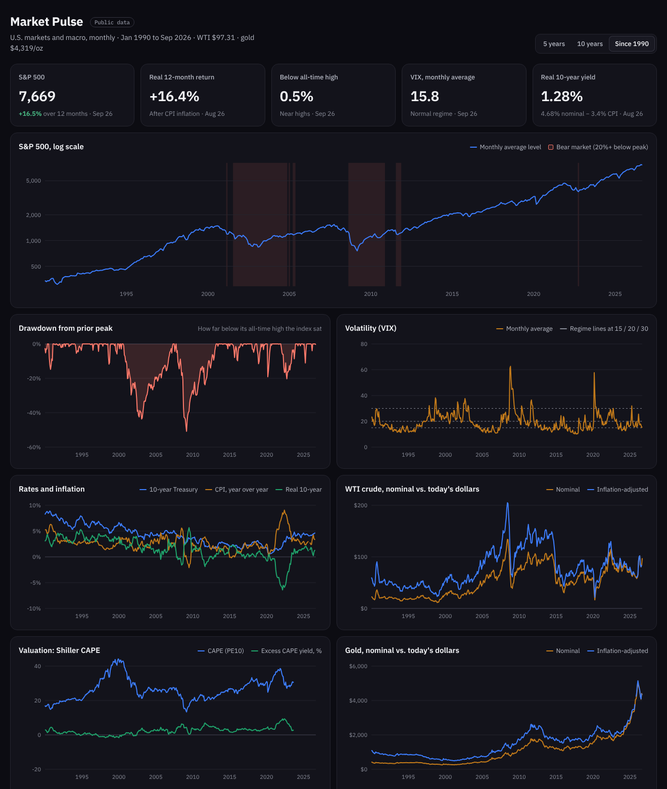
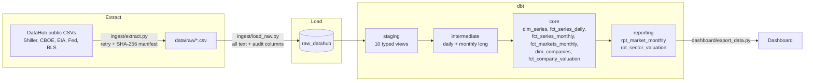

# Market Pulse

An end-to-end ELT pipeline on real public data. It **extracts** a set of financial market and macro series (S&P 500, VIX, oil, natural gas, gold, Treasury yields, CPI and S&P 500 company fundamentals), **loads** them untouched into a warehouse landing zone, and **transforms** them with dbt into a tested star schema and two reporting marts that feed a dashboard.

It runs locally on DuckDB in about 15 seconds, and the same dbt project targets Snowflake.



## What it answers

- How are U.S. stocks doing in **real** terms, after inflation, and how far are they from their high?
- What volatility regime are we in (VIX calm / normal / elevated / stress), and how does it line up with drawdowns?
- What is the real 10-year yield, and how do equity valuations (Shiller CAPE, excess CAPE yield) compare with it?
- What do oil and gold cost in today's dollars compared with past peaks?
- Which sectors carry the index's weight, and how are they valued on a cap-weighted basis?

## Architecture



| Layer | Schema | What happens there |
|---|---|---|
| Raw | `raw_datahub` | Exact copy of each file, every column as text, plus `_source_file`, `_source_url`, `_loaded_at`. The extract manifest is loaded too. |
| Staging | `staging` | Typing, renaming, null handling, one model per source table. |
| Intermediate | `intermediate` | Every series stacked into one long table, then rolled up to month grain (average, month-end close, low, high, trading days). |
| Core | `core` | Series catalog with coverage, daily and monthly facts, a wide month table, company dimension and valuation snapshot. |
| Reporting | `reporting` | The two marts the dashboard reads. |

Adding a new series is one extract entry, one staging model, one union branch and one seed row.

## Data quality, handled in the pipeline

Public data is messier than it looks. Each of these is handled in code and counted on the dashboard:

- **Zero padding.** Shiller's file pads months it hasn't published with `0.0`. Read literally, that's a CAPE of zero. Staging turns those into nulls (159 values).
- **Stale fundamentals.** CAPE, earnings and dividends in the public file stop in 2023. A freshness test (`assert_series_are_fresh`) warns on every build instead of letting the gap go unnoticed.
- **Mislabelled columns.** The company snapshot's `Sector` column actually holds the sub-industry, so it's renamed, and the true GICS sector comes from the constituent list.
- **Point-in-time mismatch.** The valuation snapshot is older than the constituent list. 29 companies have since left the index; they're kept but excluded from sector rollups. 17 rows with no figures are dropped.
- **Real outliers stay.** WTI settled at **−$36.98** on April 20, 2020. That's not an error, so the range test allows it.
- **Formats.** Gold dates arrive as `YYYY-MM`, VIX values carry six decimals as text, natural gas has a blank holiday row.

## Tests

78 tests run with `dbt build`:

- `unique` / `not_null` on every grain, plus `unique_combination` on the long facts
- `relationships` from facts to `dim_series`
- `value_between` (custom generic test) range checks to catch unit and parsing errors, e.g. VIX 5–100, 10-year yield 0–20%, monthly S&P return within ±35%
- `accepted_values` on GICS sectors, volatility regimes and market phases
- Singular tests:
  - `assert_rows_reconcile_to_manifest`: raw row counts match what the extractor downloaded
  - `assert_month_close_matches_last_daily`: monthly close equals the last daily print
  - `assert_sector_weights_sum_to_one`
  - `assert_no_future_observations`
  - `assert_series_are_fresh` (warn)
- Source freshness on `_loaded_at`

## Metric definitions

| Metric | Definition |
|---|---|
| 12-month return | S&P 500 monthly average level ÷ the level 12 months earlier − 1 |
| Real 12-month return | (1 + nominal return) ÷ (1 + CPI change over the same 12 months) − 1 |
| Drawdown | Level ÷ highest level to date (since 1871) − 1 |
| Market phase | Near highs (> −5%), Pullback (−5 to −10%), Correction (−10 to −20%), Bear market (≤ −20%) |
| Volatility regime | Monthly average VIX: Calm < 15, Normal 15–20, Elevated 20–30, Stress ≥ 30 (configurable in `dbt_project.yml`) |
| Real 10-year yield | 10-year Treasury yield − CPI year-over-year inflation |
| Excess CAPE yield | 100 ÷ CAPE − real 10-year yield |
| Today's dollars | Nominal price × latest CPI ÷ CPI in that month |
| Aggregate P/E | Total market cap ÷ total earnings for companies with positive earnings (how index providers compute it) |

## Run it

```bash
git clone https://github.com/evannwilsonn/market-pulse.git
cd market-pulse
python -m venv .venv && source .venv/bin/activate
make setup     # pip install -r requirements.txt
make all       # extract → load → dbt build → export dashboard data
make serve     # http://localhost:8000
make docs      # dbt docs with the lineage graph
```

## Run it on Snowflake

The models use cross-database macros (`macros/cross_db.sql`) that dispatch to DuckDB or Snowflake SQL, so the transform layer is identical on both. The Snowflake path is written to run as-is but has only been run end to end on DuckDB so far.

```bash
pip install dbt-snowflake
python ingest/extract.py
snowsql -a <account> -u <user> -f ingest/snowflake_load.sql   # stage + COPY INTO raw_datahub

export SNOWFLAKE_ACCOUNT=<account> SNOWFLAKE_USER=<user> SNOWFLAKE_PASSWORD=<password>
export SNOWFLAKE_ROLE=ACCOUNTADMIN SNOWFLAKE_WAREHOUSE=COMPUTE_WH   # or your own role/warehouse
dbt build --target snowflake
```

## Sources

Every dataset is public domain (ODC-PDDL), republished by the [DataHub core datasets](https://github.com/datasets) project:

| Raw table | Underlying publisher |
|---|---|
| `shiller_sp500_monthly` | Robert Shiller / S&P (monthly since 1871) |
| `cboe_vix_daily` | CBOE (daily since 1990) |
| `eia_wti_daily`, `eia_brent_daily`, `eia_henry_hub_daily` | U.S. Energy Information Administration |
| `gold_monthly` | World Gold Council / Bundesbank (monthly since 1833) |
| `fed_ust10y_monthly` | Federal Reserve |
| `bls_cpi_monthly` | U.S. Bureau of Labor Statistics |
| `sp500_constituents`, `sp500_financials` | S&P 500 membership and a company valuation snapshot |

The extract manifest (`data/raw/_manifest.json`) records the URL, row count and SHA-256 of every file pulled.

## Stack

Python · DuckDB · dbt-core (dbt-duckdb / dbt-snowflake) · Snowflake · SQL · HTML/SVG dashboard with no chart library

Built by Evan Wilson. This is a data engineering portfolio project, not investment advice.
